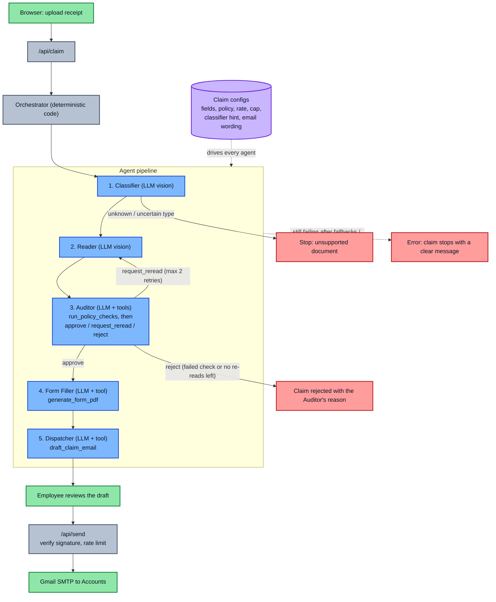

# ClaimCrew

ClaimCrew is a multi-agent receipt-to-reimbursement demo built for the SSI Agent-A-Thon. It turns an internet bill or health club receipt into a ready-to-send reimbursement claim: the app classifies the receipt, extracts the required fields, audits the claim against policy, fills the company form, and drafts the email to Accounts for final approval.

Live demo: https://claim-crew.vercel.app/

Emails are sent only after the user reviews the draft and clicks Approve & Send.

## Business value

**Who benefits:** Employees filing reimbursement claims at SSI (or any client with similar policy forms), and the Accounts team that processes those claims.

Filing an expense claim today means filling out forms and writing emails by hand. With ClaimCrew, an employee uploads a receipt and the app checks it against company rules, fills in the form and writes the email, and they only click approve. Accounts get complete, consistent claims with fewer mistakes and fewer follow-up emails. (Demo uses made-up data only.)

## Architecture



Blue boxes are LLM agents, grey boxes are plain code, purple is the claim config data, red are end states where no claim is sent, and green are the employee and the mailbox. The dotted line to the error node means any agent that still fails after trying the backup models (tool-calling agents also retry once on a bad tool call) stops the claim with a clear error, with no silent fallback. The LLM perceives and decides, and code owns policy and money: tools validate every action, and the email is a fixed template signed in code so only the reviewed draft can be sent.

**Adding a claim type:** each claim type is one config entry (fields, policy, rate, cap, classifier hint, email wording) plus one form template registered in `lib/form-generators.ts`. The Classifier prompt, tool schemas, Reader, Auditor and email pick it up from the config, so the agents and policy checks need no changes.

## 5-Agent Flow

1. **Classifier** decides whether the receipt is an internet bill, a health club receipt, or an unsupported document.
2. **Reader** extracts the required fields for the detected claim type. If required fields are missing or low-confidence, it retries with a focused re-read.
3. **Auditor** is a tool-calling agent. It first calls `run_policy_checks` (plain code that checks confidence, year, expense type, amount and the claim-type cap), reads the results, then decides by calling one tool: `approve_claim`, `request_reread` (naming the fields) or `reject_claim`, with its own reason. The tools enforce the hard rules in code: a claim with a failed check can't be approved, and once re-reads run out the model must reject. The orchestrator then sends a re-read request back to the Reader. Tools live in `lib/tools/audit-tools.ts`.
4. **Form Filler** is a tool-calling agent. It is told the requested output format (PDF today), the model picks and calls the matching tool, and the tool fills in the company form and works out the reimbursable amount. A bad or missing tool call is retried once, then the claim stops with a clear error. New formats (Word, Excel) are added by registering one more tool in `lib/tools/form-tools.ts`.
5. **Dispatcher** is also a tool-calling agent. It is told the requested channel (email today), the model picks and calls the matching tool, and the tool builds the fixed-template email to Accounts and signs it so only this exact draft can be sent. The model never writes or edits the email. Same retry-once-then-error rule. Nothing is sent until the employee clicks Approve & Send. New channels (Slack, Teams) are added by registering one more tool in `lib/tools/dispatch-tools.ts`.

The **orchestrator** (`lib/orchestrator.ts`) is deterministic by design: it runs the agents in order, routes on the Classifier's and Auditor's results, runs the Reader-Auditor loop, and tells the Form Filler and Dispatcher which format and channel to produce. Shared tool-calling logic lives in `lib/tools/tool-agent.ts`: the model calls a tool, our code validates and runs it (sending results back to the model when the tool is informational), and a bad call is retried once.

**Design principle:** the LLM handles perception and decisions, and code owns policy and money. Each agent's tools enforce the rules (amounts, caps, signatures, allowed actions), so the model chooses within boundaries and can't act outside them. The UI shows each tool the agents chose on their cards.

## Policy and Retry Loop

| Claim type | Reimbursement | Monthly cap |
| --- | --- | --- |
| Internet bill | 100% of the bill | 2000 |
| Health club | 60% of monthly dues (rounded to 2 decimals) | 4000 on the 60% share |

- Every extracted field is required, and the receipt must be from the current year. Unrecognised or uncertain documents are rejected by the Classifier.
- If a field is missing or low-confidence, the Auditor requests a re-read and the claim goes back to the Reader, up to 2 retries. Image retries read a contrast-enhanced copy. On the final pass the Auditor is told no re-reads are left and rejects the claim with its own reason.
- Over-cap health club claims are still approved. The Auditor adds a note and Accounts applies the cap.

## Try It

Sample receipts (all made-up) are on the landing page, covering a clean claim, retry then reject, retry then recover, and an immediate reject. Receipts can be dragged in (JPG, PNG, WebP, HEIC or PDF, up to 4 MB), and a running claim can be stopped.

## Stack

- **Framework**: Next.js App Router, React, TypeScript
- **UI**: Tailwind CSS
- **LLM**: OpenAI-compatible API through the `openai` SDK
- **PDF generation**: `pdf-lib`
- **Email**: Gmail SMTP through `nodemailer`
- **Image processing**: `sharp`
- **Deployment**: Vercel

## Environment Variables

Create `.env.local` for local development and set the same values in Vercel for deployment. Do not commit secrets.

| Variable | Purpose |
| --- | --- |
| `LLM_BASE_URL` | OpenAI-compatible endpoint |
| `LLM_API_KEY` | API key for that endpoint |
| `LLM_MODEL` | Primary model (needs vision) |
| `LLM_FALLBACK_MODELS` | Comma-separated models tried if the primary fails |
| `MOCK_LLM` | Defaults to `true` if unset: runs the pipeline with canned output and no LLM calls. Set to `false` to use the real LLM |
| `GMAIL_USER` | Gmail address used to send |
| `GMAIL_APP_PASSWORD` | Gmail app password |
| `ACCOUNTS_EMAIL` | Demo mailbox that receives claims |
| `DRAFT_SIGNING_SECRET` | Random secret used to sign email drafts (not sent to the client). Generate one and set it in Vercel and `.env.local` |

## Run Locally

Install dependencies:

```bash
npm install
```

Start the development server:

```bash
npm run dev
```

Open [http://localhost:3000](http://localhost:3000).

## Useful Scripts

```bash
npm run dev
npm run build
npx tsc --noEmit
npm run lint
```

## Notes

- Sample receipts live in `public/samples` and use made-up data.
- The app requires the user to enter a designation before starting a claim.
- The CC email is required at the approval step so the user receives a copy of the exact email sent to Accounts.
- Sending is limited (best-effort, in memory per server instance) to 100 emails per IP per hour and 250 per day.
- Real API keys and Gmail app passwords must stay in `.env.local` or Vercel environment variables.
